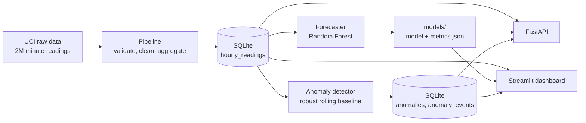

# EnergyPulse: Energy Analytics, Forecasting and Anomaly Detection

[](https://github.com/YOUR_USERNAME/energypulse/actions/workflows/ci.yml)


An end-to-end Python project that turns four years of minute-level household electricity readings into a clean database, a day-ahead forecaster, an anomaly detector, a REST API and an interactive dashboard.

## Contents

- [Highlights](#highlights)
- [Features](#features)
- [Architecture](#architecture)
- [Dataset and data pipeline](#dataset-and-data-pipeline)
- [Results](#results)
- [Getting started](#getting-started)
- [API reference](#api-reference)
- [Dashboard](#dashboard)
- [Project structure](#project-structure)
- [Design decisions](#design-decisions)
- [Limitations and future work](#limitations-and-future-work)
- [Testing and CI](#testing-and-ci)
- [Acknowledgements](#acknowledgements)

## Highlights

| | |
|---|---|
| **Data** | 2.07 million minute readings (Dec 2006 to Nov 2010), cleaned and aggregated to 34,589 hourly rows; 98.8% of hours usable |
| **Forecast** | Next-24-hour model with MAE of 0.457 kWh per hour on a held-out year, **20% lower error** than the best naive baseline |
| **Anomalies** | Robust, per-hour baselines that flag spikes and dips and merge them into events |
| **Serving** | FastAPI service with typed responses and a Streamlit dashboard |
| **Quality** | Automated tests on synthetic data, linting and continuous integration |

<!--
Add screenshots here once you have them, for example:

## Screenshots


-->

## Features

- **Energy analytics:** hourly and daily consumption trends, peak usage, weekday versus weekend comparisons and a weekday-by-hour heatmap.
- **Forecasting:** next-24-hour consumption forecasts from a Random Forest, compared against "same hour yesterday" and "same hour last week" baselines, with a back-test for any past day.
- **Anomaly detection:** unusual hours flagged against a rolling statistical baseline, grouped into events.
- **Data pipeline:** validation, missing-value handling, hourly aggregation and SQLite storage, with every filled or missing hour flagged.
- **Interactive dashboard:** date filters, KPI cards, Plotly charts and CSV exports.
- **REST API:** endpoints for readings, forecasts, anomalies and model metrics, with pagination and validated inputs.
- **Testing:** automated tests for data processing, forecasting, anomaly detection, database queries and the API.

## Architecture



## Dataset and data pipeline

The project uses the [Individual Household Electric Power Consumption](https://archive.ics.uci.edu/dataset/235/individual+household+electric+power+consumption) dataset from the UCI Machine Learning Repository: one household, one reading per minute, December 2006 to November 2010. The raw file is semicolon-separated, marks missing values with `?`, and is not included in this repository.

The pipeline (`python -m energypulse.pipeline`) works in stages:

1. **Load:** parse the day-first timestamps, treat `?` as missing, drop duplicate or unparseable timestamps.
2. **Validate:** convert columns to numbers and null out physically impossible values (the safety ranges removed nothing from this dataset).
3. **Aggregate to hourly:** an hour is trusted only if at least 45 of its 60 minutes were measured. The hourly mean of power in kW equals that hour's energy in kWh.
4. **Handle gaps:** gaps of up to 3 hours are interpolated and flagged `is_imputed`; longer outages stay empty and are flagged `is_long_gap`. Missing hours are never treated as zero.
5. **Store:** write the hourly table to SQLite, flags included.

Outcome: 34,589 hourly rows, of which 34,159 are usable, 8 were interpolated and 430 sit inside 7 long outages (from about 15 hours to 5 days).

## Results

### What the data looks like

- About 1.3% of minutes are missing. The 71 gaps split cleanly into 64 short ones (at most 83 minutes) and 7 long outages.
- Daily rhythm: roughly 0.44 kWh per hour overnight, a sharp rise at 7 am, and an evening peak near 1.9 kWh at 8 to 9 pm.
- Weekends use about 19% more than weekdays. Winter months use roughly twice as much as July.
- August 2008 is a clear outlier (about 206 kWh, likely an empty house).

### Forecasting

Setup: day-ahead forecasts built only from data at least 24 hours old, trained on Dec 2006 to Nov 2009 (25,256 hours) and tested on the final year, Nov 2009 to Nov 2010 (7,948 usable hours). Hyperparameters were fixed in advance, so the test year was never used for tuning.

| Model | MAE (kWh/h) | RMSE (kWh/h) | MAPE | sMAPE |
|---|---|---|---|---|
| Same hour yesterday | 0.573 | 0.842 | 69.6% | 50.2% |
| Same hour last week | 0.585 | 0.845 | 74.0% | 52.4% |
| **Random Forest** | **0.457** | **0.632** | 63.2% | 44.0% |

The Random Forest cuts MAE by 20.2% against the better baseline. MAPE is inflated by very quiet hours, so MAE and RMSE are the fairer guides. The most important features were the same hour last week, the hour of day and the same hour yesterday.

Error analysis (`notebooks/02_forecast_analysis.ipynb`):

- The model beats the yesterday baseline at every hour of the day, with the largest gains at 7 to 9 am and 11 am to 3 pm, and in 12 of the 13 test months. The exception is August 2010, a steady, low-use month where repeating yesterday works well.
- The hardest hours are 7 to 10 pm (MAE about 0.65 kWh); the easiest are 3 to 5 am (about 0.19).
- The worst days are around holidays and unusual absences (for example Christmas Eve 2009), which no lag feature can anticipate.
- Peaks are under-predicted: forecasts never exceed about 3.3 kWh while actual use reaches 5.6. The worst 5% of hours account for 19% of total error, and about 90% of errors fall within plus or minus 1 kWh.

### Anomaly detection

Each hour is compared with the same hour on the previous 5 weeks of the same day type (weekday or weekend), so a normal evening peak is never flagged. Scores use relative change on a log scale with the median and median absolute deviation, which resist distortion by past anomalies. An hour is flagged when its robust z-score exceeds 3.5 and it differs from normal by at least 0.25 kWh; consecutive flagged hours are merged into events.

There is no labeled ground truth, so the detector includes a self-test: it multiplies or divides random hours by known factors and reports how many are caught. Running `python -m energypulse.anomaly` prints this together with a sensitivity table for the window length and threshold.

## Getting started

### Prerequisites

- Python 3.11 or newer
- Git

### Install

```bash
git clone https://github.com/YOUR_USERNAME/energypulse.git
cd energypulse
python -m venv .venv

# Windows
.venv\Scripts\activate
# macOS / Linux
source .venv/bin/activate

pip install -r requirements-dev.txt
pip install -e .
```

### Get the data

Download the ZIP from the [UCI page](https://archive.ics.uci.edu/dataset/235/individual+household+electric+power+consumption), extract `household_power_consumption.txt` (about 127 MB) and place it in `data/raw/`.

### Run

```bash
python -m energypulse.pipeline    # raw file -> data/processed/energypulse.db
python -m energypulse.forecast    # train, evaluate, save the model and metrics
python -m energypulse.anomaly     # detect anomalies and save them to the database

python -m uvicorn energypulse.api:app --reload    # API at http://127.0.0.1:8000/docs
python -m streamlit run dashboard/app.py          # dashboard at http://localhost:8501
```

### Test

```bash
python -m pytest
ruff check .
```

The tests use small synthetic datasets, so they run without downloading anything.

## API reference

Interactive documentation is generated at `/docs` when the server is running.

| Endpoint | Description |
|---|---|
| `GET /health` | Service status, whether the database and model exist, data range |
| `GET /readings` | Hourly readings, paginated. Parameters: `start`, `end`, `limit`, `offset`, `usable_only` |
| `GET /forecast` | Forecast for the 24 hours after the latest data, or after `as_of`, with real values attached for past origins |
| `GET /anomalies` | Flagged hours. Parameters: `start`, `end`, `direction` (`spike` or `dip`), `limit`, `offset` |
| `GET /anomalies/events` | Flagged hours merged into events |
| `GET /metrics` | Held-out accuracy of the forecaster against the baselines |

Example: `GET /forecast?as_of=2010-03-01T00:00:00` forecasts from 1 March 2010 using only earlier data and returns the actual consumption alongside for comparison. Missing data is returned as `null`, bad inputs return `422`, and anything not yet built returns `503` with the command to run.

## Dashboard

| Tab | What it shows |
|---|---|
| **Overview** | KPI cards (average per day, average power, peak hour, completeness), trend at hourly, daily, weekly or monthly resolution, CSV downloads |
| **Patterns** | Average day for weekdays versus weekends, average by weekday, weekday-by-hour heatmap |
| **Forecast** | Next 24 hours, a back-test for any chosen day against reality and the yesterday baseline, model accuracy table and feature importances |
| **Anomalies** | Consumption with flagged hours marked, events table, spike and dip filters, CSV downloads |
| **Data quality** | Real versus interpolated versus missing hours, a list of long outages, completeness by month |

## Project structure

```
energypulse/
├── .github/workflows/ci.yml      # lint + tests on every push and pull request
├── dashboard/app.py              # Streamlit dashboard (layout only)
├── data/
│   ├── raw/                      # UCI file goes here (contents gitignored)
│   └── processed/                # SQLite database (gitignored)
├── models/                       # trained model and metrics (gitignored)
├── notebooks/
│   ├── 01_eda.ipynb              # exploratory analysis
│   └── 02_forecast_analysis.ipynb# forecast error analysis
├── src/energypulse/
│   ├── config.py                 # paths and settings
│   ├── pipeline.py               # load, validate, clean, aggregate, store
│   ├── features.py               # leakage-safe forecasting features
│   ├── forecast.py               # baselines, Random Forest, evaluation, back-tests
│   ├── anomaly.py                # robust rolling-baseline detector and self-test
│   ├── analytics.py              # dashboard calculations (KPIs, trends, patterns)
│   ├── db.py                     # read-only database queries
│   ├── schemas.py                # API response models
│   └── api.py                    # FastAPI application
├── tests/                        # pytest suite (synthetic data)
├── pyproject.toml
├── requirements.txt
└── requirements-dev.txt
```

## Design decisions

- **Forecast features look back at least 24 hours.** A single model can then predict every hour of the next day from data available at forecast time, with no recursive predictions and no leakage. A test proves that changing recent data does not change the features.
- **Chronological split, baselines first.** The final year is held out, and every claim is measured against naive forecasts.
- **Missing data is never zero.** Averages and totals ignore missing hours or are adjusted for them, and long outages are flagged rather than filled.
- **Robust, relative anomaly scoring.** Baselines are per hour and day type, scored on a log scale with median-based statistics. Judging raw kWh flagged almost only spikes and over-flagged autumn, when consumption rises.
- **Safe data access.** The API opens the database read-only and passes every parameter through placeholders, never into the SQL text.
- **Logic separated from presentation.** Queries, calculations and models live in tested modules; the API and dashboard are thin layers on top.

## Limitations and future work

- One household in one location, with no weather or holiday information. The model cannot anticipate absences, holidays or unusual evenings, and it under-predicts peaks.
- The anomaly detector has no ground truth and is validated with injected anomalies. A long unusual stretch becomes the new normal after about half the baseline window, and a seasonal ramp can still raise flags slightly.
- The API has no authentication and the project is not deployed.
- Ideas: holiday and absence features, per-hour prediction intervals, gradient boosting tuned with time-series cross-validation, containerized deployment.

## Testing and CI

`python -m pytest` runs unit tests for the pipeline, features, forecasting, anomaly detection, database queries, analytics and the API. GitHub Actions runs `ruff check .` and the test suite on every push to `main` and on every pull request.

## Acknowledgements

Data: Hebrail, G. and Berard, A., *Individual Household Electric Power Consumption*, UCI Machine Learning Repository. See the [dataset page](https://archive.ics.uci.edu/dataset/235/individual+household+electric+power+consumption) for its license and citation details.


